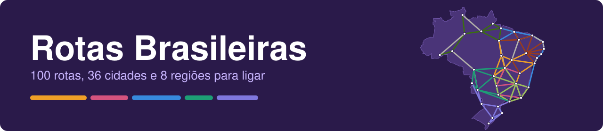
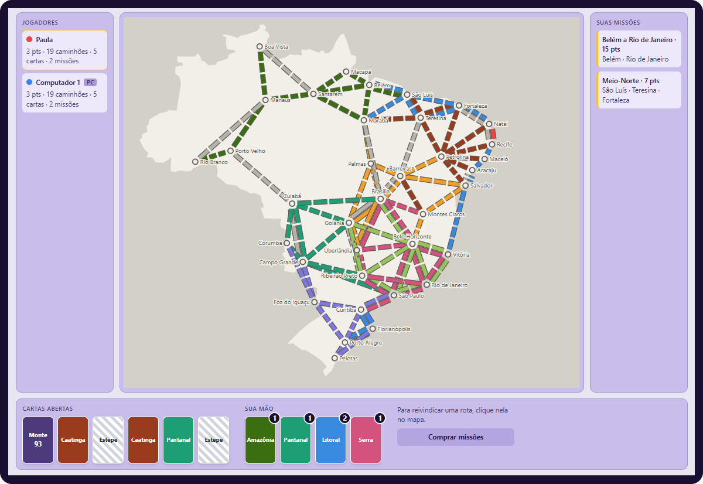

  

# rotas-brasileiras

Jogo de tabuleiro no navegador, inspirado em Ticket to Ride, com o mapa do Brasil. De 2 a 5 jogadores no mesmo computador, e cada vaga pode ser uma pessoa ou o computador.

  

  
  
  
  
  

  

## Índice

- [Como funciona](#como-funciona)
- [O que muda em relação ao jogo original](#o-que-muda-em-relação-ao-jogo-original)
- [Como rodar](#como-rodar)
- [Organização do código](#organização-do-código)
- [Próximos passos](#próximos-passos)

## Como funciona

Cada jogador começa com 45 caminhões (20 na partida rápida) e liga cidades construindo rotas pelo mapa. Antes da primeira jogada, cada um recebe 3 missões e fica com pelo menos 2. Na sua vez, o jogador faz uma destas ações:

| Ação | O que acontece |
| --- | --- |
| Comprar cartas | Pega 2 cartas, do monte ou das abertas na mesa. O Estepe aberto vale a vez inteira |
| Reivindicar uma rota | Paga com cartas da cor dela e ganha os pontos do tamanho da rota |
| Comprar missões | Saem 3 missões e o jogador fica com pelo menos 1 |

As cartas são de 8 regiões (Amazônia, Cerrado, Pantanal, Caatinga, Mata Atlântica, Pampa, Litoral e Serra), mais o Estepe, que vale como coringa.

### Pontos por rota

| Espaços | 1 | 2 | 3 | 4 | 5 | 6 |
| --- | --- | --- | --- | --- | --- | --- |
| Pontos | 1 | 2 | 4 | 7 | 10 | 15 |

## O que muda em relação ao jogo original

| Diferencial | Como funciona |
| --- | --- |
| Missões | Ligar as cidades indicadas rende pontos, e quem não consegue perde pontos no fim |
| Dia e noite | A cada amanhecer sai uma carta de evento que muda as regras para todos até o próximo amanhecer. O tema da tela também troca entre noite e dia |
| Curiosidades | Ao ligar uma cidade, o jogador descobre uma curiosidade sobre ela, com a fonte da informação, e ganha 1 ponto |
| Fim de jogo | Quando alguém termina a vez com 2 caminhões ou menos, todos jogam mais uma rodada. O caminho mais longo vale 10 pontos extras |
| Partida rápida | Opção de 20 caminhões por jogador, para jogos mais curtos |
| Computador | Cada jogada do computador aparece numa janela que explica o que ele fez, e o jogo só segue depois do "Entendi" |

### Eventos do dia

| Evento | Efeito |
| --- | --- |
| Chuva forte | Rotas de 4 ou mais espaços custam 1 carta a mais |
| Greve de caminhoneiros | Ninguém reivindica rotas de 4 ou mais espaços |
| Estrada liberada | Rotas de 1 e 2 espaços custam 1 carta a menos (mínimo 1) |
| Feriado prolongado | Cada jogador compra até 3 cartas por turno, em vez de 2 |
| Neblina | As cartas abertas ficam viradas: só se compra do monte |
| Pedágio | Toda rota reivindicada exige 1 carta extra, de qualquer cor |
| Boleia amiga | Cada Estepe conta como 2 cartas da cor escolhida |
| Céu limpo | Rotas de 5 ou 6 espaços rendem +2 pontos |

> [!TIP]
> O botão "Como jogar", na tela inicial e durante a partida, explica o jogo passo a passo, na ordem em que as coisas acontecem.

## Como rodar

É preciso ter o Node.js instalado.

 **Clone o repositório**

~~~
git clone https://github.com/Paula-Thamyres/rotas-brasileiras.git
cd rotas-brasileiras
~~~

 **Instale as dependências**

~~~
npm install
~~~

 **Abra o jogo**

~~~
npm run dev
~~~

> [!NOTE]
> O jogo abre em http://localhost:5173/.

Para rodar os testes e gerar a versão de produção:

~~~
npm test
npm run build
~~~

## Organização do código

| Pasta | O que tem |
| --- | --- |
| `src/engine` | Regras do jogo, em funções puras (baralho, rotas, partida, missões e computador) |
| `src/data` | Mapa, missões, eventos e curiosidades em JSON |
| `src/types` | Tipos compartilhados |
| `src/hooks` | Estado da partida |
| `src/components` | Telas e peças do jogo |
| `src/ui` | Textos e funções de apoio das telas |

As regras ficam separadas da interface, por isso são testadas sem abrir o navegador.

## Próximos passos

- Ajustes a partir dos testes com outras pessoas

  

